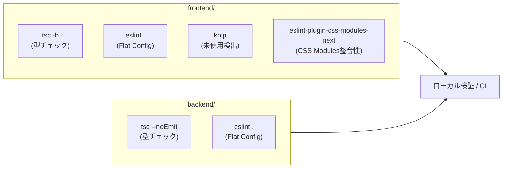

# Lint & 静的解析ガイドライン (`Lint.md`)

本ドキュメントは、プロジェクト「もうつく」における**コードの冗長性・設計の破綻・AIによる意図しない改変の再発防止**を目的とした、Lint・静的解析ツールの構成・運用ルールです。

---

## 1. 導入している静的解析ツールと構成

本プロジェクトでは、フロントエンド・バックエンドそれぞれに以下のツールチェーンを配備しています。



| 領域 | ツール | 設定ファイル | 主な検証内容 |
| :--- | :--- | :--- | :--- |
| **フロントエンド** | ESLint 10 (Flat Config) | [`frontend/eslint.config.js`](file:///home/sorai/Atelier/sd_2604/frontend/eslint.config.js) | 未使用変数、CSS Modules クラス参照整合性、型 import 強制、localStorage 直接呼び出し制限、React Hooks 最適化 |
| **フロントエンド** | TypeScript 6 (`tsc -b`) | [`frontend/tsconfig.json`](file:///home/sorai/Atelier/sd_2604/frontend/tsconfig.json) | 厳格な型整合性、未使用パラメータ検証 |
| **フロントエンド** | Knip | [`frontend/package.json`](file:///home/sorai/Atelier/sd_2604/frontend/package.json) | 使われなくなったファイル・関数エクスポート・npm依存関係の検知 |
| **バックエンド** | ESLint 10 (Flat Config) | [`backend/eslint.config.js`](file:///home/sorai/Atelier/sd_2604/backend/eslint.config.js) | 未使用変数・グローバル変数の放置検知、Cloudflare Workers グローバル環境対応 |
| **バックエンド** | TypeScript (`tsc --noEmit`) | [`backend/tsconfig.json`](file:///home/sorai/Atelier/sd_2604/backend/tsconfig.json) | Workers ランタイム型整合性検証 |

---

## 2. 実行コマンド一覧

日常の開発や PR 作成前、AI にコード生成・リファクタリングを指示した直後は、以下のコマンドで整合性を検証してください。

### フロントエンド (`frontend/`)

```bash
cd frontend

# 型チェック（ビルド検証）
npm run typecheck      # tsc -b

# ESLint チェック
npm run lint           # eslint .

# 未使用ファイル・エクスポート・依存関係の検知
npm run knip           # knip

# 本番ビルド検証
npm run build          # tsc -b && vite build
```

### バックエンド (`backend/`)

```bash
cd backend

# 型チェック
npm run typecheck      # tsc --noEmit

# ESLint チェック
npm run lint           # eslint .
```

---

## 3. 防ぐべき問題と設定ルールの詳細

AI や複数人開発で発生しやすい「設計の破綻」「冗長性の混入」を防ぐため、以下のルールを自動検知対象としています。

### 3.1 CSS Modules クラス名参照の不整合防止 (`eslint-plugin-css-modules-next`)
- **検知ルール**: `'css-modules/no-undefined-class': 'error'`
- **防止対象**:
  - `styles['entry-title entry-title--create']` のようにスペース区切りの複数クラスを 1 つのキーとして参照し、クラス適用が消滅するバグ。
  - CSS 側に定義されていないクラス名を TSX 側で参照するタイポ。
  - CSS を更新してクラス名を変更した際、TSX 側の書き換え漏れ。

### 3.2 アーキテクチャ境界の維持 (`no-restricted-globals`)
- **検知ルール**: `'no-restricted-globals': ['error', { name: 'localStorage', message: '...' }]`
- **防止対象**:
  - コンポーネントが `utils/storage.ts` の共通層を迂回して `localStorage.setItem` を直接呼び出し、キー名や保存ロジックが散乱する問題。
  - ※ `src/utils/storage.ts` のみ明示的にこのルールを除外（overrides）しています。

### 3.3 型安全とバンドル最適化 (`@typescript-eslint/*`)
- **検知ルール**:
  - `'@typescript-eslint/consistent-type-imports': ['error', { prefer: 'type-imports' }]`
    - 型の import に `import type { ... }` を強制。トランスパイル時のランタイムコード混入を防ぎ、循環依存や Vite でのトランスパイル不整合を防止。
  - `'@typescript-eslint/no-explicit-any': 'warn'`
    - AI が型エラーを解決できずに安易に `any` で型定義を破壊することを警告。
  - `'@typescript-eslint/no-unused-vars': ['error', { argsIgnorePattern: '^_', varsIgnorePattern: '^_' }]`
    - 未使用の変数・関数・import をエラーとし、不要コードの蓄積を防止（意図的な引数は `_` プレフィックスを強制）。

### 3.4 不要ファイル・デッドコードの検出 (`knip`)
- **検知対象**:
  - ハッカソン期間中に発生した「中身を空（0 byte）にしたまま放置されたファイル（`mapTypes.ts`）」や、リファクタリングで使われなくなった旧ユーティリティ（旧 `mapMath.ts`）。
  - package.json に残された未使用の devDependencies / dependencies。

---

## 4. AI 支援開発におけるチェックフロー

AI を用いて新規コードの実装やリファクタリングを行った際は、コミット前に必ず以下の順序で静的解析を実行してください。

1. **型チェックの実行**:
   ```bash
   cd frontend && npm run typecheck
   cd ../backend && npm run typecheck
   ```
2. **Lint の実行**:
   ```bash
   cd frontend && npm run lint
   cd ../backend && npm run lint
   ```
3. **デッドコード・未使用ファイルの棚卸し**:
   ```bash
   cd frontend && npm run knip
   ```
4. **ビルド検証**:
   ```bash
   cd frontend && npm run build
   ```

すべてエラー 0 件でパスすることを確認してからブランチをプッシュまたはマージしてください。
